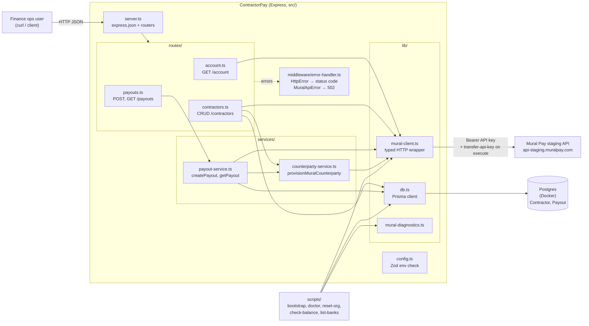
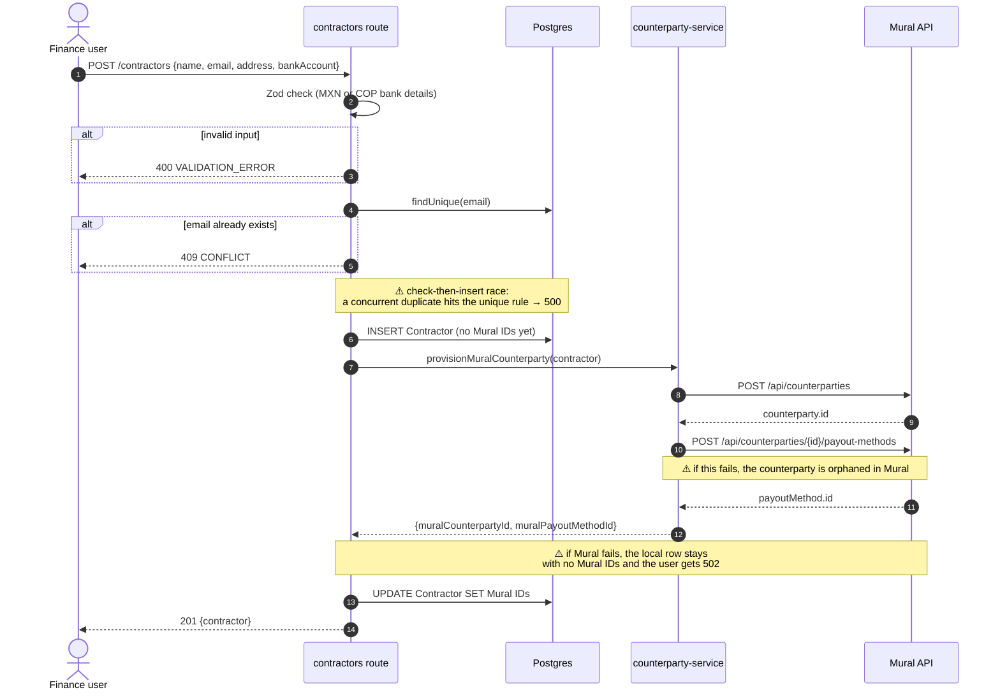
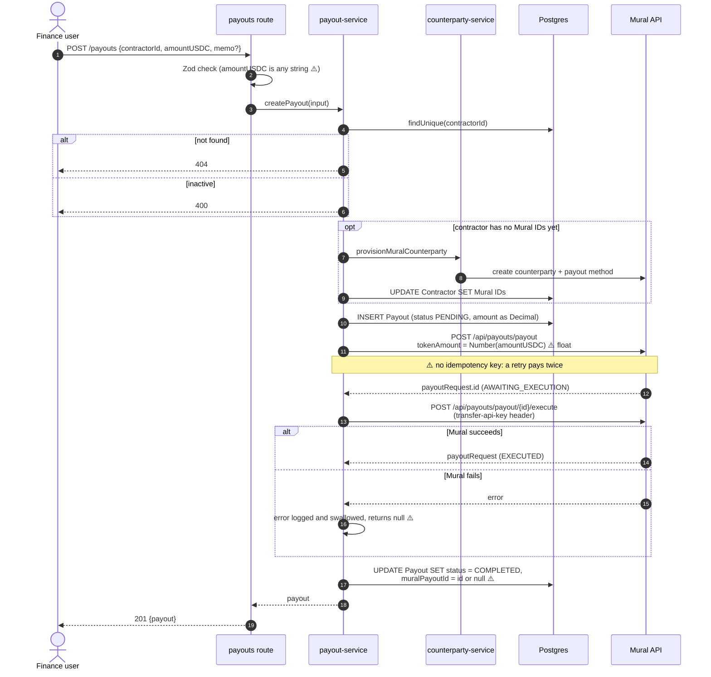
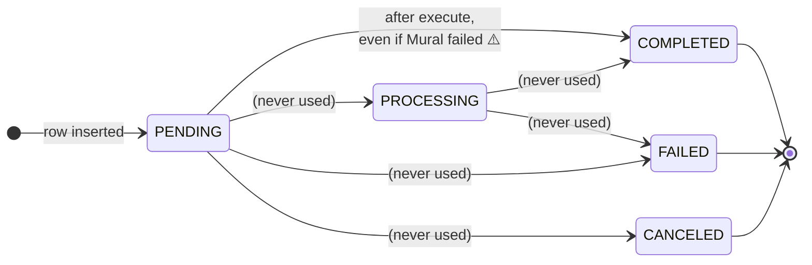
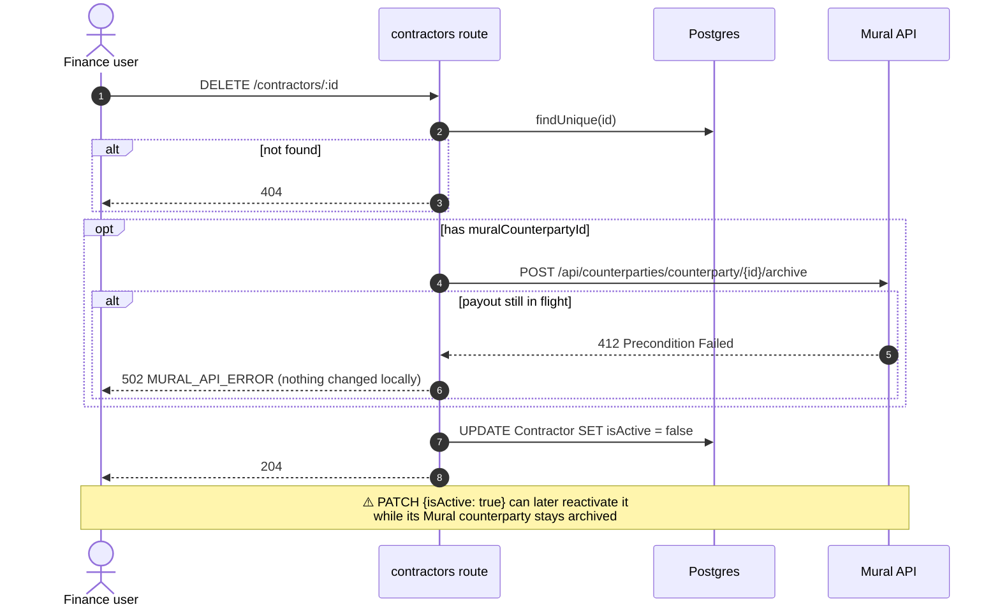
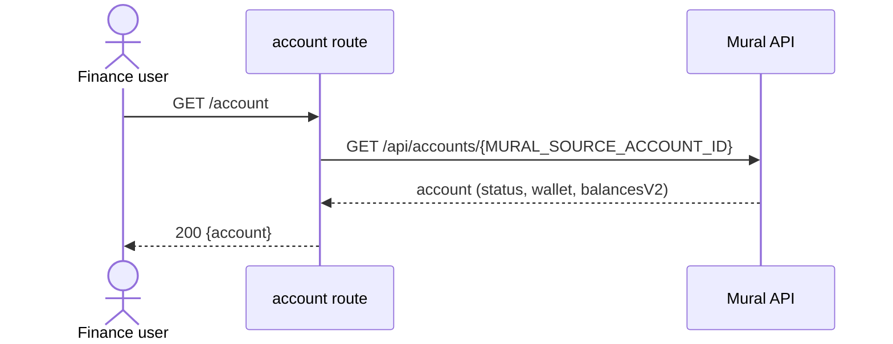
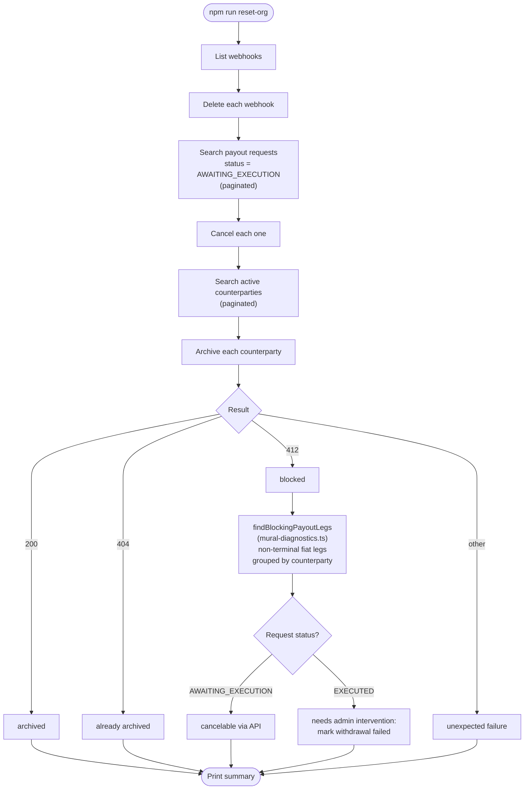
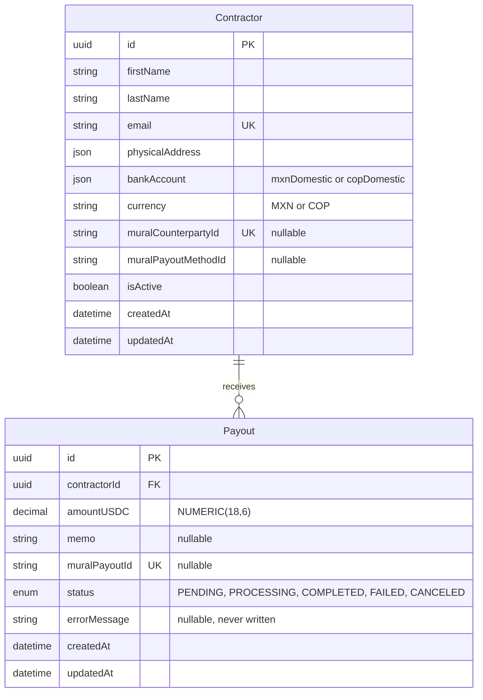

# ContractorPay: architecture and flow diagrams

These diagrams use Mermaid, which renders on GitHub, in VS Code (with a Mermaid
preview extension) and at https://mermaid.live. They show the code as it is
today, gaps included. Notes marked ⚠️ point to weak spots listed in
`CODEBASE_SUMMARY.md`.

1. [Architecture](#1-architecture)
2. [Create a contractor](#2-create-a-contractor)
3. [Create and execute a payout](#3-create-and-execute-a-payout)
4. [Payout status lifecycle](#4-payout-status-lifecycle)
5. [Delete (deactivate) a contractor](#5-delete-deactivate-a-contractor)
6. [Read the account balance](#6-read-the-account-balance)
7. [Reset the Mural org (ops script)](#7-reset-the-mural-org-ops-script)
8. [Data model](#8-data-model)

---

## 1. Architecture

---

## 2. Create a contractor

`POST /contractors` in `src/routes/contractors.ts`.

---

## 3. Create and execute a payout

`POST /payouts` in `src/routes/payouts.ts` and `src/services/payout-service.ts`.

The failure path ends the same way as the success path: the payout is marked
`COMPLETED` with no Mural ID.

---

## 4. Payout status lifecycle

The `PayoutStatus` enum in `prisma/schema.prisma`, compared with what the code
actually does.

Only `PENDING` → `COMPLETED` is ever written. Mural settles fiat payouts after
execution, but there are no webhooks or polling, so nothing moves a payout to
`PROCESSING`, `FAILED` or `CANCELED`.

---

## 5. Delete (deactivate) a contractor

`DELETE /contractors/:id` in `src/routes/contractors.ts`.

---

## 6. Read the account balance

`GET /account` in `src/routes/account.ts`. This is where money enters the
system: USDC is deposited to the wallet address returned here.

---

## 7. Reset the Mural org (ops script)

`npm run reset-org` (`scripts/reset-org.ts`) clears the shared sandbox between
interviews. It doesn't touch the local database.

---

## 8. Data model

From `prisma/schema.prisma`.

